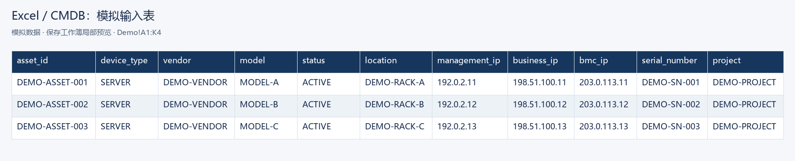
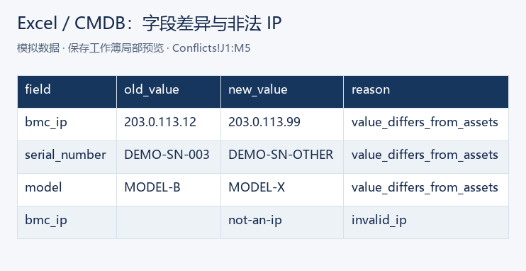

# Excel / CMDB 多来源核对工具

用于处理多来源 Excel/CSV 数据核对、去重、差异检测和异常报告，可用于资产盘点、CMDB 核对、库存整理等场景。


> **Demo notice:** This repository is a synthetic portfolio example. It contains no client data and does not claim a customer production deployment.

这是一套可运行的公开演示实现：把资产基准表、BMC 信息表和现场采集表逐行对照，找出匹配、冲突、缺失、重复与非法 IP。演示数据均为模拟生成，不包含真实生产环境信息。

## 使用场景与输入

适合收到几份设备清单、需要先定位不一致行再人工复核的工作。默认示例提供 `demo/assets.xlsx`、`demo/bm.xlsx`、`demo/collected.csv`，也可替换为自己的 `.xlsx` 或 UTF-8 `.csv`。三份表均使用第一行为表头；字段可以只提供相关列，支持 `asset_id`、`serial_number`、`management_ip`、`bmc_ip`、`model` 等 [字段清单](src/audit.py)。每个数据行都保留来源和原行号。

Python 3.10+ 环境中，从项目根目录执行：

```bash
pip install -r requirements.txt
python audit.py --assets demo/assets.xlsx --bm demo/bm.xlsx --collected demo/collected.csv --output output
```

需要重建示例输入时运行 `python demo/generate_demo.py`；测试命令是 `python -m pytest -q`。

## 输出效果

`output/audit_result.xlsx` 含 Summary、Matched、Conflicts、Missing、Duplicates 工作表；同时生成 `matched.csv`、`conflicts.csv`、`missing.csv`、`duplicates.csv` 和 `summary.json`。非法 IP 的详细记录归入 Conflicts 表，`status` 列保留 `INVALID`。





展示图来自保存工作簿的实际单元格，是局部渲染预览。公开版在 Windows / Python 3.12 的独立环境通过 14 项测试；执行记录见 [验证记录](docs/verification.json)，具体依赖版本见 [已验版本](docs/validated-dependencies.txt)。

每条差异记录包含 `source`、`source_row`、`matched_asset_row`、`match_key`、`field`、`old_value`、`new_value`、`reason`。一个输入行可能产生多条字段差异或同时有非法 IP 和重复标识符；两种异常会分别出现在 Conflicts 和 Duplicates。`summary.json` 的主状态计数仍按输入行各计一次，优先顺序为 INVALID、DUPLICATE、CONFLICT、MISSING、MATCHED，明细行数另记。`assets` 是基准表，其 `MATCHED` 表示该行已被 `collected` 唯一关联；未被采集表关联的基准行列入 Missing。`bm` 和 `collected` 的 `MATCHED` 仅表示已提供的非空字段与基准一致；空字段仍是未采集，不代表完整数据一致。`affected_row_counts` 按明细状态统计去重后的受影响输入行数，可跨状态重复计入；检查全部重复涉及行数应查看它的 `DUPLICATE`，而不是互斥的主状态计数。

内置演示输入共 12 个数据行：`assets=3`、`bm=3`、`collected=6`。预期状态计数为 `MATCHED=4`、`CONFLICT=3`、`MISSING=2`、`DUPLICATE=2`、`INVALID=1`；采集表唯一关联 2 个基准资产，另 1 个基准资产未被采集表关联。`summary.json` 提供 `input_rows`、`source_rows`、`status_counts`、`source_status_counts`、`detail_rows`、`affected_row_counts`、`collected_coverage` 与计数说明。四个 CSV/工作表承载全部明细，`detail_rows` 等于其记录行数之和。

匹配键依次为序列号、资产编号、管理 IP、BMC IP。若两个非空标识符指向不同的基准行，结果为 `CONFLICT`；标识符在任一同源表重复或基准候选不唯一时为 `DUPLICATE`，不会自动取第一行。IP 非法为 `INVALID`；没有可关联的资产为 `MISSING`。非空采集字段与基准不同会输出字段差异。空的新字段视为“未采集”，不会凭空写出一致结论；可从原输入行追查。

本版采用严格相等关联，不提供模糊匹配或人工修正。Excel 公式作为文本读入，不执行公式；特殊控制字符在导出时写为可见的 `\uXXXX`，可通过来源行号回查。建议在实际业务场景先确认字段含义和基准表权威性。

## 项目结构

- `audit.py`：命令入口。
- `src/audit.py`：读取、标准化、核对与报告导出。
- `demo/`：模拟输入及生成脚本。
- `tests/`：核心场景测试。
- `docs/case-summary.md`：案例说明。
- `output-example/`：使用模拟输入生成的示例输出。

## 隐私说明

演示数据均为模拟生成，不包含真实生产环境信息。所有演示 IP 属于文档保留网段（`192.0.2.0/24`、`198.51.100.0/24`、`203.0.113.0/24`），编号均以 `DEMO-` 开头。工具在本地读取表格、写入指定输出目录；使用真实数据时应自行控制文件访问与报告流转。该公开版是依据实际资产核对与批量表格处理工作类型重构的通用示例，不代表已在任何客户生产环境部署。
